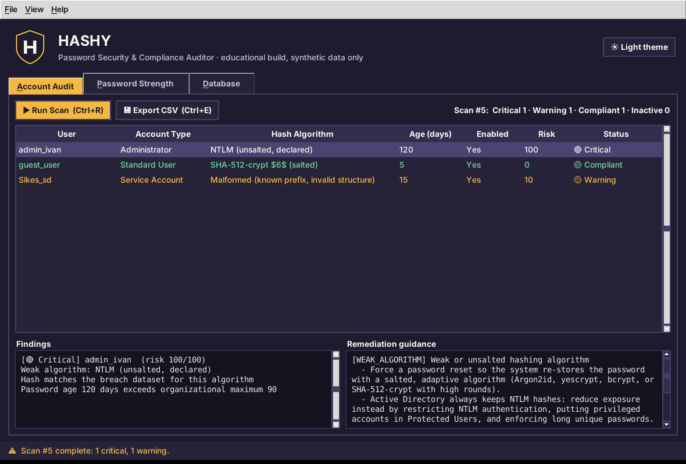
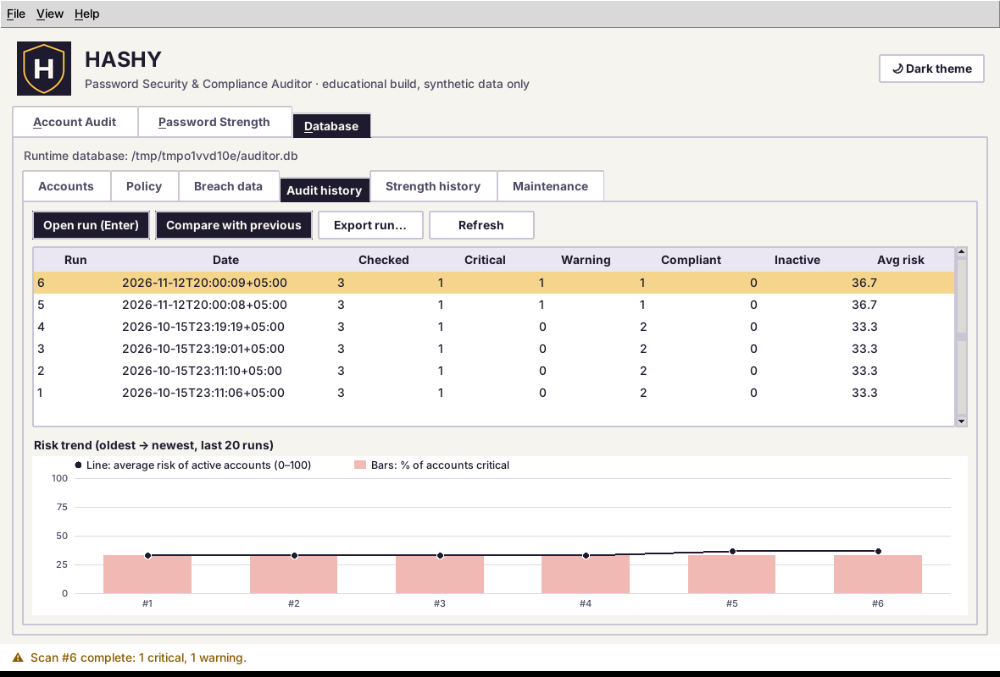

# HASHY: Password Security & Compliance Auditor

Educational desktop tool (Python + Tkinter + SQLite) that audits **synthetic** account
password hashes and evaluates password strength against one stored policy.

> **Canonical build.** This folder (`HASHY`) is the only maintained implementation.
> The separate `/password` folder in the original archive is an alternate prototype;
> move it to `archive/` or delete it so reviewers test one build.

## Quick start (Windows, VS Code)

1. Install Python 3.10+ from python.org (Tkinter and SQLite are included).
2. Open the folder in VS Code → **Terminal → New Terminal**.
3. Run `py main.py` (or double-click `run.bat`). On macOS/Linux: `./run.sh`.
4. Run the tests: `py -m unittest -v` (47 tests, no extra packages).

No third-party dependencies (`requirements.txt` is intentionally empty).
On Linux, install Tk if missing: `sudo apt install python3-tk`.

## Architecture

```
main.py (Tkinter GUI)
  ├─ connector.py ── database.py ── data/auditor.db (runtime SQLite, not shipped)
  │                      └─ sample_data.py (synthetic seed, used only for a new DB)
  ├─ auditor.py ── remediation.py (issue codes, scores, guidance)
  ├─ strength_checker.py (uses the SAME SystemPolicy from SQLite)
  └─ hashing.py (MD4/NTLM + MD5 reference functions for documented sample data)
models.py: enums + SystemPolicy shared by every layer
```

| Module | Responsibility |
| --- | --- |
| `main.py` | GUI: audit, strength checker, database tabs, themes, shortcuts, status bar |
| `auditor.py` | Hash interpretation, reuse, breach matching, age rule, risk score |
| `strength_checker.py` | Entropy, blocklist, patterns, policy checks, NIST subset (reference) |
| `database.py` | Schema + migrations, backup/restore, integrity, breach import, exports |
| `remediation.py` | Catalogue of findings: code → points → remediation steps |
| `sample_data.py` | Synthetic seed data and documented breach-entry derivation |

## What the audit checks (risk model)

| Code | Points | Rule |
| --- | --- | --- |
| `WEAK_ALGORITHM` | 30 | NTLM, MD5, ambiguous 32-hex, or MD5-crypt |
| `PASSWORD_REUSE` | 40 | Identical **unsalted** hash on 2+ accounts (proof of same password) |
| `DUPLICATE_SALTED_RECORD` | 40 | Identical **salted** string on 2+ accounts (copied record / reused salt) |
| `BREACHED` | 50 | Hash matches breach data **for the same algorithm** |
| `EXPIRED` | 20 | Age > policy max age (organizational rule, not a NIST requirement) |
| `UNASSESSABLE_HASH` | 10 | Empty, unknown or malformed hash: never reported as compliant |
| `AMBIGUOUS_FORMAT` | 0 | 32-hex value without a declared source format |
| `INACTIVE_ACCOUNT` | 0 | Disabled account: status **Inactive**, risk still shown |

Score = sum, capped at 100. **Critical ≥ 50**, Warning 1–49, Compliant 0.

Why: a bare 32-hex string can be NTLM *or* MD5, so the source must declare it
(`hash_format`). Salted hashes differ even for the same password, so string comparison
can never prove reuse or match a breach corpus; only unsalted values can.

## One password policy

`password_policy` in SQLite drives both tabs (edit it in **Database → Policy**).
The original build used 8 in the database and 12 in the checker; migration keeps
the stricter value (12). The strength verdict follows the policy only. The
**NIST SP 800-63B-4 subset** row (length ≥ 15 for single-factor, ≤ 64 accepted,
blocklist) is reference information, **not a compliance certification**.

## Data protection

- Runtime DB: `data/auditor.db` (override with the `HASHY_DB` environment variable).
  It is created from `sample_data.py` on first start and is git-ignored.
- An `auditor.db` from the old build placed beside `main.py` is copied into `data/`
  once and migrated; a `pre-migration` backup is written first.
- Backups: `data/backups/` (SQLite online backup API). Restore runs
  `PRAGMA integrity_check` first and backs up the current DB.
- Typed passwords are never stored. Hashes are masked in the GUI and never exported.
  CSV cells are protected against spreadsheet formula injection.
- On Linux/macOS the DB file is chmod 600 and the backup folder 700.

## Breach data

`breach_entries(hash_value, algorithm, source, added_at)`. The sample is
reproducible: NTLM and MD5 of every entry in `COMMON_PASSWORDS`, plus the original
sample value (source recorded). Import more with **Database → Breach data → Import**:
one 32-hex value per line or HIBP `HASH:COUNT` format (e.g. NTLM output of the
official Pwned Passwords downloader). Every import requires a source.

## Keyboard shortcuts

Ctrl+R scan · Ctrl+E export · Ctrl+B backup · Ctrl+T theme · Ctrl+1/2/3 tabs ·
Ctrl+N add account · Delete remove account · Enter open run · F5 refresh · Esc close ·
F1 help.

## Scope & limitations

- Synthetic data only. No connection to Active Directory, `/etc/shadow` or online
  breach APIs.
- Entropy is a charset estimate; it overrates human-chosen passwords.
- The blocklist has 23 entries; real deployments need a large breached-password corpus.
- Salted hashes are interpreted by format only; their strength depends on parameters
  (cost/rounds) that are not scored.
- The SQLite database is not encrypted. Never store real hashes in it.
- Lockout threshold is stored but not evaluated (no authentication events offline).

## Screenshots

| Account audit (dark) | Risk history & trend (light) |
| --- | --- |
|  |  |
